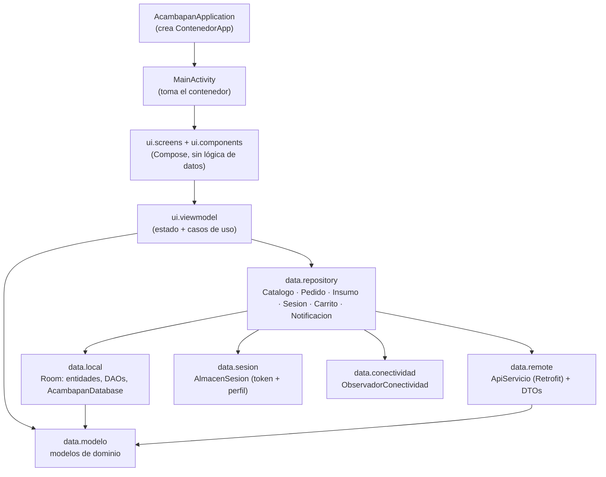
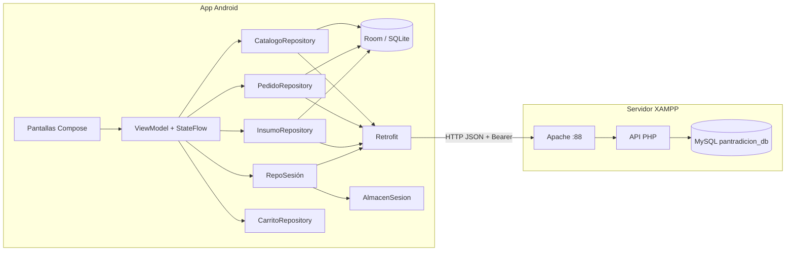
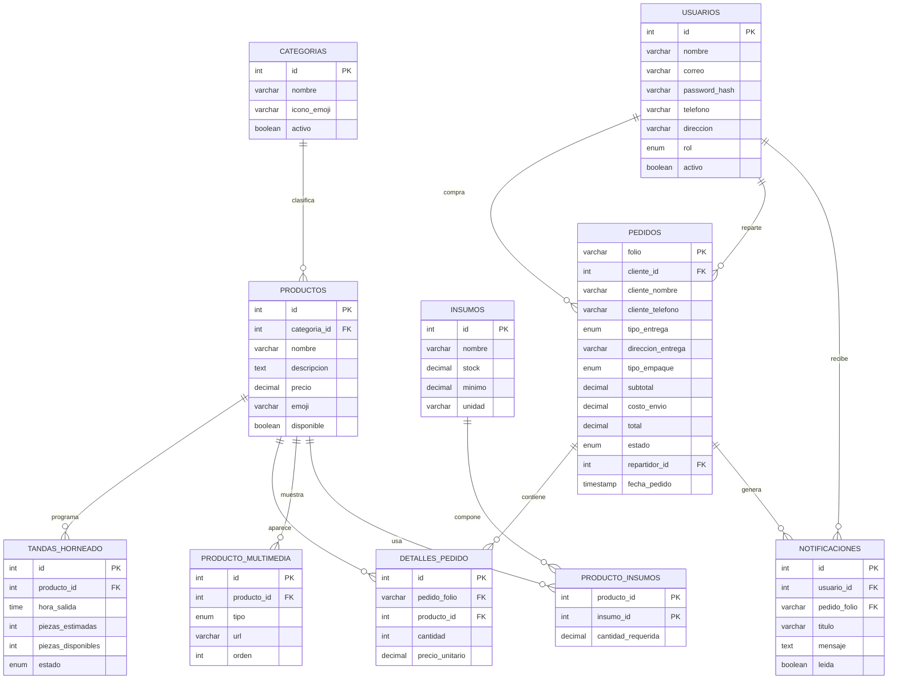
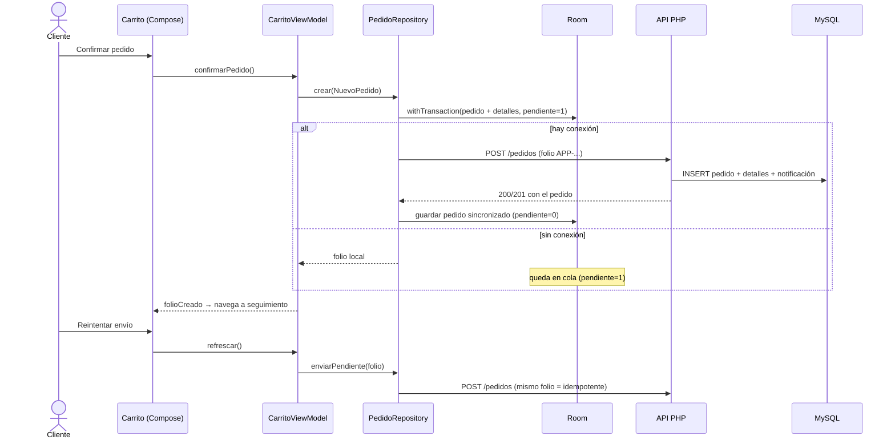
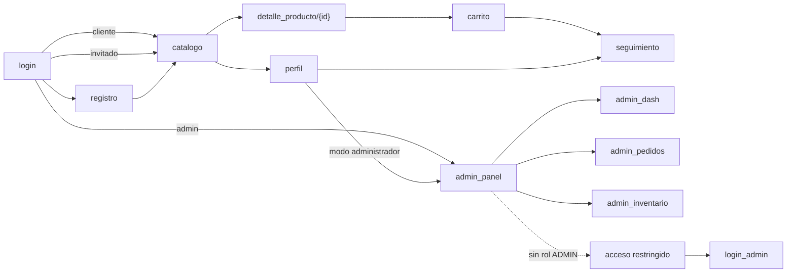

# Arquitectura de Acambapan

Documento de arquitectura y modelo de datos de la app Android **Acambapan**
(ventas en línea de una panadería), con su Web API y su base de datos.

- App: Kotlin + Jetpack Compose, `minSdk 29`, `targetSdk 37`.
- Persistencia local: **Room (SQLite)**.
- Servicio: **PHP 8 + MySQL/MariaDB** en XAMPP (`C:\xampp\virtualhost\panaderia`).
- Cliente HTTP: **Retrofit + OkHttp + Gson**.

---

## 1. Arquitectura en capas

La app sigue el flujo que pide la entrega:

```
Application → Activity → Compose → ViewModel → Repository → Room (local)
                                                          ↘ Retrofit (remoto)
```



Reglas que sostienen el diseño:

1. **La interfaz no conoce datos**: las pantallas reciben estado y devuelven
   eventos; nada de SQL ni URLs en Compose.
2. **El repositorio es la única puerta a los datos**: decide si responde Room o
   la API, y mantiene la copia local al día.
3. **Una sola fuente de verdad local**: la interfaz siempre observa `Flow` de
   Room, por eso funciona sin conexión y se actualiza sola al sincronizar.
4. **Inyección manual**: `ContenedorApp` arma base de datos, API y repositorios
   una sola vez; los ViewModel reciben sus dependencias por constructor con una
   `fabrica(...)`. Sin frameworks de DI, fácil de leer y de defender.

### Paquetes

```
com.devnoway.posproyect
├── AcambapanApplication.kt     Application: crea el contenedor
├── MainActivity.kt             Activity: monta el tema y el NavHost
├── di/ContenedorApp.kt         composición de dependencias
├── data/
│   ├── modelo/                 modelos de dominio (Producto, Pedido, ...)
│   ├── local/                   Room: entidades, DAOs y base
│   ├── remote/                  Retrofit, DTOs y manejo de errores de red
│   ├── repository/              catálogo, pedidos, insumos, sesión, carrito, avisos
│   ├── sesion/                  token y perfil persistentes
│   ├── conectividad/            estado de la red
│   └── mapeadores/              DTO ↔ Entidad ↔ Modelo
├── navigation/                  Rutas + NavHost + candado de administrador
└── ui/
    ├── viewmodel/               11 ViewModel con StateFlow
    ├── screens/                 11 pantallas
    ├── components/              piezas reutilizables
    └── theme/                   colores y tipografía de la marca
```

---

## 2. Diagrama de componentes



---

## 3. Diagrama de despliegue

```mermaid
flowchart TB
    subgraph Cloudflare
        T["Túnel ch1984<br/>acambapan.devnoway.com"]
    end

    subgraph Equipo de desarrollo (Windows)
        subgraph XAMPP
            A["Apache 2.4<br/>Listen 88 · ServerAlias acambapan.devnoway.com"]
            P["PHP 8.2<br/>panaderia/api/index.php"]
            M[("MariaDB 10.4<br/>pantradicion_db")]
        end
        A --> P --> M
        ADB["adb reverse (solo desarrollo local)"]
    end

    subgraph Emulador Android
        E["App Acambapan<br/>Room acambapan.db"]
    end

    subgraph Teléfono físico
        F["App Acambapan<br/>Room acambapan.db"]
    end

    T -->|http://localhost:88| A
    E -->|"https://acambapan.devnoway.com/api/"| T
    F -->|"https://acambapan.devnoway.com/api/"| T
    E -.->|"http://10.0.2.2:88/api/ (opcional)"| A
    E -.->|"http://127.0.0.1:88/api/ (opcional)"| ADB --> A
```

La app consume la API por **HTTPS a través del túnel**, así funciona igual en el
emulador, en un teléfono con datos móviles o en otra red. El origen sigue siendo
el XAMPP del equipo (`localhost:88`); el túnel termina el TLS.

La URL no está incrustada en las pantallas: se genera en
`BuildConfig.API_BASE_URL` y se puede cambiar al compilar:

```bat
gradlew :app:assembleDebug -PapiBaseUrl=http://10.0.2.2:88/api/
```

---

## 4. Modelo de datos

10 tablas: las 8 del script original más `notificaciones` y
`producto_multimedia` (modelo y DAOs pedidos para la entrega).



### Equivalencia Room ↔ MySQL

| Tabla MySQL | Entidad Room | DAO |
| --- | --- | --- |
| `categorias` | `CategoriaEntity` | `CatalogoDao` |
| `productos` | `ProductoEntity` | `CatalogoDao` |
| `tandas_horneado` | `TandaEntity` | `TandaDao` |
| `usuarios` | `UsuarioEntity` | `UsuarioDao` |
| `pedidos` | `PedidoEntity` | `PedidoDao` |
| `detalles_pedido` | `DetallePedidoEntity` | `PedidoDao` |
| `insumos` | `InsumoEntity` | `InsumoDao` |
| `producto_insumos` | `ProductoInsumoEntity` | `RecetaDao` |
| `notificaciones` | `NotificacionEntity` | `NotificacionDao` |
| `producto_multimedia` | `MultimediaEntity` | `MultimediaDao` |

Room guarda una columna extra en `pedidos`: `pendiente_sincronizar` (1 = se creó
sin conexión y todavía no llegó al servidor). No existe en MySQL porque es estado
del cliente.

---

## 5. Flujo online / offline (pedido)



Otras operaciones:

| Operación | Sin conexión | Con conexión |
| --- | --- | --- |
| Ver catálogo, tandas, inventario, perfil | Room | Room + `GET` para refrescar |
| Crear pedido | Room (cola) | Room + `POST` |
| Cambiar estado de pedido (admin) | Aviso: requiere red | `PUT` + actualización local |
| Crear/editar/eliminar insumo | Aviso: requiere red | `POST/PUT/DELETE` + copia local |
| Iniciar sesión / registrarse | Aviso: requiere red | `POST /auth/...` + token guardado |

---

## 6. Navegación



Las rutas de administrador están protegidas en el `NavHost`: si la sesión no
tiene rol `ADMIN`, se muestra la pantalla de candado en lugar del contenido.

---

## 7. Reglas de negocio implementadas

1. **Envío**: $30 a domicilio; gratis desde $250. Para recoger no hay envío.
2. **Folio**: el servidor genera `ACB-####`; la app genera `APP-xxxx` cuando crea
   el pedido sin conexión. El servidor acepta el folio del cliente y responde el
   mismo pedido si se repite (idempotencia, sin duplicados).
3. **Totales**: el servidor recalcula `subtotal` y `total`; no confía en el
   cliente. `detalles_pedido.subtotal` es columna generada en MySQL.
4. **Estados**: `RECIBIDO → EN_PREPARACION → EN_CAMINO → ENTREGADO`; cualquier
   estado no final puede pasar a `CANCELADO`. El servidor valida y responde 409.
5. **Inventario**: no se puede borrar un insumo usado en una receta.
6. **Avisos**: cada cambio de estado crea una fila en `notificaciones`.
7. **Sesión**: token HMAC de 12 h; el rol se revalida en cada petición.

---

## 8. Trazabilidad con la entrega

| Criterio de `peticiones de entrega nuevas.txt` | Dónde está |
| --- | --- |
| Documento de arquitectura y diagramas (BD, paquetes, componentes, despliegue) | este documento |
| 100 % de UI definida y ≥ 75 % funcional | 11 pantallas en `ui/screens`, todas conectadas a su ViewModel; catálogo, detalle, carrito, pedido, perfil, login, registro, panel, dash, pedidos e inventario funcionan contra datos reales |
| Navegación concluida (NavHost) | `navigation/NavegacionAcambapan.kt` + `Rutas.kt` |
| Repository local (SQLite-Room) y remoto (Retrofit) | `data/repository` + `data/local` + `data/remote` |
| Dependencias: application → activity → compose → viewmodel → repository → local/remoto | `AcambapanApplication`, `MainActivity`, `di/ContenedorApp` |
| Entidades, DAOs y base; transacciones | 10 entidades, 8 DAOs, `AcambapanDatabase`; transacciones con `withTransaction` al crear pedidos y guardar del servidor |
| ≥ 50 % de funcionalidades de BD (agregar, editar, ver, eliminar, listar) | catálogo (ver/listar), pedidos (crear/listar/ver/cambiar estado/cancelar), insumos (crear/editar/listar/eliminar), notificaciones (listar/marcar leída), multimedia (listar por producto) |
| Modelo y DAOs listos para notificaciones y multimedia | `NotificacionEntity` + `NotificacionDao`, `MultimediaEntity` + `MultimediaDao` |
| ≥ 50 % de peticiones a la Web API (agregar, editar, ver, eliminar, listar, recuperar) | `/auth`, `/categorias`, `/productos`, `/tandas`, `/pedidos` (POST/GET/PUT/DELETE), `/insumos` (CRUD), `/resumen`, `/notificaciones` |
| Modelos y configuración JSON | `data/remote/dto/Dtos.kt` + Gson en `ApiCliente` |

### Pendiente (siguiente entrega)

- Pantallas de direcciones, métodos de pago y bandeja de notificaciones.
- Mostrar la multimedia del producto (el modelo y los datos ya existen).
- Seguimiento en tiempo real (push/WebSocket); hoy se refresca al abrir o con ⟳.
- Pasarela de pago y app del repartidor.
- Migraciones de Room (`version = 1`, `fallbackToDestructiveMigration` no usado).
- Tests instrumentados de DAOs y de la API.

---

## 9. Cómo compilar

```bat
rem APK de depuración (la URL por defecto es el túnel)
gradlew :app:assembleDebug

rem Contra el XAMPP local (desarrollo sin internet)
gradlew :app:assembleDebug -PapiBaseUrl=http://10.0.2.2:88/api/
```

Nota de toolchain: el proyecto usa **AGP 9 con Kotlin integrado**, y KSP registra
sus fuentes generadas con `kotlin.sourceSets`. Por eso `gradle.properties`
incluye `android.disallowKotlinSourceSets=false`; sin esa bandera la
configuración falla antes de compilar. Requiere JDK 17 o superior (funciona con
el JBR de Android Studio).
